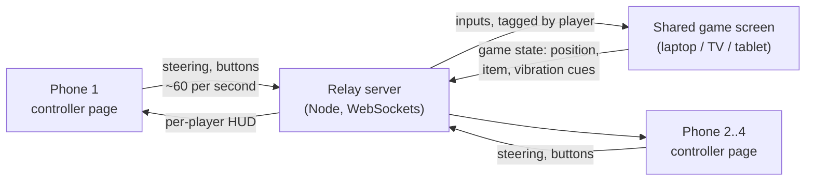

# Architecture

The race runs on **one shared screen**. Every player's **phone is only a controller**. A small **relay server** sits between them.



| Part | Runs on | Job | Arrives in |
| --- | --- | --- | --- |
| Controller page | Each player's phone browser | Read the gyro and buttons, send input, show a mini HUD | Phase 1 (local only), Phase 2 (sends to server) |
| Relay server | The laptop during dev; a small host when shipped | Pair phones with a game by room code, forward messages | Phase 2 |
| Game screen | Any big-screen browser | 3D world, physics, race rules, rendering | Phase 3 |

Why a server in the middle: browsers can't open a direct connection to each other without help, and a server gives one place to manage rooms, player slots and reconnects.

## Repo layout

```text
mario-kart/
├── index.html            Dev hub: links to the controller and game pages
├── controller/           Phone controller page
│   ├── index.html
│   ├── main.js           Page logic: permission, sensor events, UI
│   ├── steering.js       Pure steering math (tilt -> -1..+1), unit-tested
│   └── style.css
├── game/                 Shared game screen (placeholder until Phase 3)
├── server/               Relay server (placeholder until Phase 2)
├── shared/theme.css      Colours and type shared by every page
├── public/               Static files served as-is (favicon)
├── test/                 Unit tests, run with `npm test`
├── docs/                 You are here
└── vite.config.js        Dev server: HTTPS, LAN access, QR code, visit log
```

## Tooling

- **Vite** serves every page during development and bundles them for release. Plain JavaScript, no framework, so the browser APIs stay visible while learning.
- **@vitejs/plugin-basic-ssl** gives the dev server a self-signed HTTPS certificate, which phones require before they'll share motion sensors.
- **Node's built-in test runner** (`node --test`) runs the unit tests; no extra test library.
