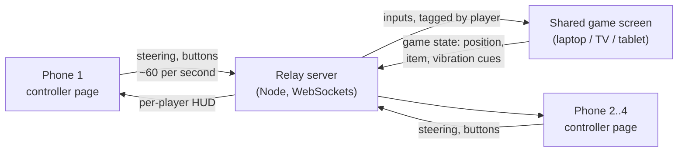

# Architecture

The race runs on **one shared screen**. Every player's **phone is only a controller**. A small **relay server** sits between them.



| Part | Runs on | Job | Arrives in |
| --- | --- | --- | --- |
| Controller page | Each player's phone browser | Read the gyro and buttons, send input, show a mini HUD | Phase 1 (steering), Phase 2 (joins a room, streams input) |
| Relay server | Inside the dev server during development; a small host when shipped | Pair phones with a game by room code, forward messages | Phase 2 |
| Game screen | Any big-screen browser | Phase 2: room code, QR, live dials. Phase 3+: 3D world, physics, race rules | Phase 2, racing from Phase 3 |

Why a server in the middle: browsers can't open a direct connection to each other without help, and a server gives one place to manage rooms, player slots and reconnects. It holds no game logic; that all lives on the game screen. Message list and reconnect rules: [phase-2-networking.md](phase-2-networking.md).

## Repo layout

```text
mario-kart/
├── index.html            Dev hub: links to the controller and game pages
├── controller/           Phone controller page
│   ├── index.html
│   ├── main.js           Permission, sensor events, joining a room, sending input, UI
│   ├── steering.js       Pure steering math (tilt -> -1..+1), unit-tested
│   └── style.css
├── game/                 Shared game screen
│   ├── index.html
│   ├── main.js           Opens a room, QR code, live player cards
│   └── style.css
├── server/
│   ├── relay.js          Room and player rules (no networking), unit-tested
│   ├── attach.js         Puts the relay on an HTTP(S) server with WebSockets
│   └── index.js          Standalone relay for deployment (`npm run server`)
├── shared/
│   ├── protocol.js       Constants both sides agree on: slots, colours, codes, errors
│   ├── net.js            Self-healing WebSocket connection (reconnect, ping, RTT)
│   ├── relay-url.js      Where the relay is (same server by default)
│   └── theme.css         Colours and type shared by every page
├── public/               Static files served as-is (favicon)
├── test/                 Unit and network tests, run with `npm test`
├── docs/                 You are here
└── vite.config.js        Dev server: HTTPS, LAN access, relay at /ws, visit log
```

## Tooling

- **Vite** serves every page during development and bundles them for release. Plain JavaScript, no framework, so the browser APIs stay visible while learning.
- **@vitejs/plugin-basic-ssl** gives the dev server a self-signed HTTPS certificate, which phones require before they'll share motion sensors.
- **ws** is the WebSocket server library for Node. Browsers have WebSockets built in.
- **qrcode** draws the join QR code on the game screen.
- **Node's built-in test runner** (`node --test`) runs the tests; no extra test library.
