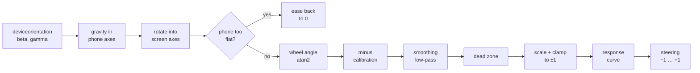

# Phase 1 — Turn phone tilt into a steering value

**Goal:** the controller page shows a live steering value from −1 (full left) to +1 (full right) that feels steady in your hands.

Code: [`controller/steering.js`](../controller/steering.js) (the math, no browser APIs) and [`controller/main.js`](../controller/main.js) (permission, sensor events, UI). Tests: [`test/steering.test.js`](../test/steering.test.js).

## Try it

1. `npm run dev`, scan the QR code, accept the certificate warning ([phase-0-setup.md](phase-0-setup.md)).
2. Tap **Tap to start**. On iPhone, tap **Allow** when asked about motion.
3. Turn the phone sideways and hold it like a steering wheel. Turn it.
4. Open **Tune** to change the dead zone, full-lock angle, smoothing and curve while you steer. Settings are saved on the phone.

No phone handy? Open the controller on your laptop: with no sensor it falls back to **← →** or **A / D**, and **C** recenters.

## The pipeline



### 1. Read the sensor

`DeviceOrientationEvent` reports three angles, in degrees, relative to the phone's own axes (x = right edge, y = top edge, z = out of the screen, all in portrait):

| Angle | Rotation about | Range | Used? |
| --- | --- | --- | --- |
| alpha | z (compass heading) | 0 to 360 | No: a wheel doesn't care which way you face, and the compass drifts |
| beta | x (tip forward/back) | −180 to 180 | Yes |
| gamma | y (tilt left/right) | −90 to 90 | Yes |

On iOS 13+ the page must call `DeviceOrientationEvent.requestPermission()` from a tap, which is why there's a Start button. Android grants it silently.

### 2. Gravity in phone axes

The tempting shortcut is "steering = gamma". It breaks: when the phone is sideways the meaning of beta and gamma swaps, and their values shift as the player leans the phone back. Instead we ask a cleaner question: **which way is down, as seen by the phone?**

The browser defines the angles as rotations applied in the order Z, then X, then Y. Undoing them on the "down" vector `(0, 0, −1)` gives:

```text
down.x =  cos(beta) · sin(gamma)
down.y = −sin(beta)
down.z = −cos(beta) · cos(gamma)
```

Check: flat on a table (beta 0, gamma 0) gives `(0, 0, −1)`, straight out the back. Upright in portrait (beta 90) gives `(0, −1, 0)`, towards the bottom edge.

### 3. Rotate into screen axes

In landscape, the screen's "right" is no longer the phone's right edge. `screen.orientation.angle` says how far the screen is rotated (90 for the usual landscape), so we rotate the vector by that angle. Now x is screen-right and y is screen-up whichever way the phone is held.

### 4. The wheel angle

Ignore the z part (how far the phone leans back) and look at gravity within the screen's plane:

```text
wheel angle = atan2(down.x, −down.y)
```

It's 0 when the screen's bottom edge faces the floor and grows as you turn the phone clockwise. Leaning the phone back only shrinks the vector, it doesn't rotate it, so steering feels the same upright or tilted back.

If the phone is nearly flat, the in-plane part (`hypot(x, y)`, shown as **upright** in the debug line) gets tiny and the angle turns to noise. Below 0.35 the controller treats it as letting go of the wheel and eases steering back to 0.

### 5. Calibration

The first reading after Start becomes "straight ahead" (`centerDeg`); **Recenter** resets it to the current hold. Every later reading is measured relative to it, wrapped into ±180° so turning across the seam at 180° doesn't jump.

### 6. Smoothing

Sensors jitter. An exponential low-pass filter moves the output a fraction of the way toward each new reading:

```text
k = 1 − exp(−dt / timeConstant)
smoothed += k · (target − smoothed)
```

Using `dt` (time since the last reading) makes it behave the same whether the sensor fires at 30 Hz or 120 Hz. A 60 ms time constant removes jitter with lag you won't notice; raise it in **Tune** and you'll feel the delay.

### 7. Dead zone, scale and clamp

- **Dead zone (default 3°):** angles this small count as 0, so a resting hand reads perfectly straight. Past the edge the value starts from 0, not from 3°, so there's no jump.
- **Full-lock angle (default 35°):** the turn that gives ±1. Anything further is clamped.

### 8. Response curve

```text
out = (1 − curve) · x + curve · x³
```

With `curve` 0 the response is linear. Raising it softens small turns (fine control on straights) while still reaching ±1 at full lock. Default 0.4.

## Other page details

| Feature | How | Notes |
| --- | --- | --- |
| Keep the screen on | Screen Wake Lock API | Re-requested when you come back to the tab. Chip shows "screen stays on". |
| Landscape | Fullscreen + `screen.orientation.lock()` on Android | iPhone Safari can't lock orientation, so a "turn your phone sideways" overlay covers the page in portrait. |
| Screen rotated mid-play | Calibration resets on the next reading | |
| Sensor rate | Readings in the last second | Expect 50–60 Hz on most phones. |
| Debug line | beta, gamma, screen angle, upright, wheel, centre, steer angle | Watch these while you tune. |

## Tests

`npm test` runs 19 unit tests on the math: gravity for known poses, screen rotation, turn direction, flat detection, dead zone, clamping, curve, smoothing convergence, recenter, release-to-zero, and the ±180° seam.

## Done when

- [ ] Holding the phone level reads about +0.00.
- [ ] A comfortable turn reaches ±1.00.
- [ ] Holding still, the number doesn't flicker.
- [ ] Turning right makes the value positive (if it's backwards on your phone, note the phone model; **Invert** in Tune is the escape hatch).
- [ ] Tested on an iPhone and an Android, if you have both.

## Next: Phase 2

Send `processor.value` to the relay server ~60 times a second so the shared game screen can show each phone's dial.
