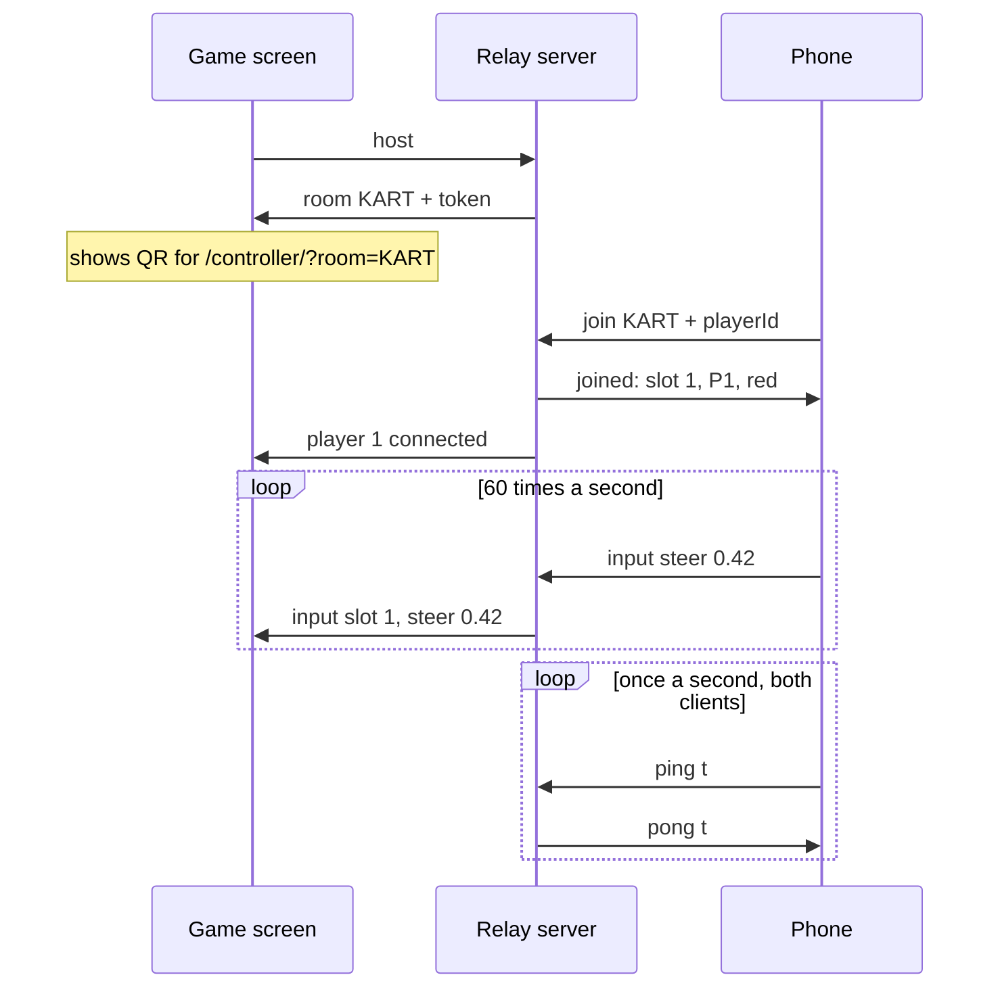

# Phase 2 — Link the phones to the game screen

**Goal:** several phones join one game screen, and each phone's tilt moves its own dial there with no visible lag (under 50 ms from tilt to screen on home Wi-Fi).

Code: [`server/relay.js`](../server/relay.js) (room rules), [`server/attach.js`](../server/attach.js) (WebSockets), [`shared/net.js`](../shared/net.js) (self-healing connection), [`shared/protocol.js`](../shared/protocol.js) (shared constants), [`game/main.js`](../game/main.js), [`controller/main.js`](../controller/main.js).

## Try it

1. `npm run dev`.
2. On your laptop open **https://localhost:5173/game/**. It shows a QR code and a 4-letter room code.
3. Scan the QR code with a phone (same Wi-Fi), accept the certificate warning, tap **Tap to start**.
4. The phone becomes P1 (red). Its dial on the game screen follows your tilt. Add more phones: P2 blue, P3 green, P4 yellow.

No second phone? Open `/controller/` in another laptop tab, type the room code, and steer with ← →. Each tab counts as its own player.

## How the pieces talk

The server never steers anything. It only matches phones to a game screen and passes messages along, tagged with which player sent them. All game logic will live on the game screen (from Phase 3).

## Why WebSockets

A normal web request is one question, one answer, then the connection is done. A **WebSocket** stays open, and either side can send a message at any time. That's what a controller needs: a steady stream of small messages with no per-message setup cost.

The relay runs inside the Vite dev server, at `/ws` on the same address and HTTPS certificate as the pages ([decisions.md](decisions.md) #8). Phones load the page and open the socket with one certificate approval.

## Messages

Every message is a small JSON object with a `type`.

| From → to | `type` | Fields | Meaning |
| --- | --- | --- | --- |
| Game → server | `host` | `code?`, `token?` | Open a room, or reclaim the one I had |
| Server → game | `room` | `code`, `token` | Your room. Keep the token to reclaim it after a reload |
| Phone → server | `join` | `code`, `playerId`, `slot?` | Put me in this room (in my old slot, if I had one) |
| Server → phone | `joined` | `code`, `slot`, `name`, `color` | You're P2, blue |
| Server → game | `player` | `slot`, `name`, `color`, `connected` | A player joined, dropped, or came back |
| Server → game | `player-removed` | `slot` | That slot's grace period ran out; it's free again |
| Server → phone | `host-status` | `connected` | Is the game screen there? |
| Phone → server | `input` | `steer`, `seq`, `rtt?` | Current steering (−1…1), a counter, my ping time |
| Server → game | `input` | `slot`, `steer`, `seq`, `rtt?` | The same, tagged with who sent it |
| Either → server | `ping` | `t` | Timestamp, for measuring round-trip time |
| Server → either | `pong` | `t` | The same timestamp, straight back |
| Server → either | `error` | `reason` | `no-room`, `room-full`, `replaced`, `room-closed` |

The server checks everything it receives: unknown types are ignored, steering is clamped to ±1, and a connection must `join` before it can send `input`.

### Fixed send rate

The phone sends its steering **60 times a second on a timer**, not on every sensor event. Sensors fire at uneven rates (50–120 Hz depending on the phone). A fixed rate gives the game a predictable stream, and Phase 3's physics can rely on it. Each message carries `seq` (a counter) so the game can later spot gaps.

## Surviving real life

Phones are hard on connections. The screen locks, the browser goes to the background, Wi-Fi blips. The design assumes connections **will** drop and makes coming back automatic.

| What happens | What the code does |
| --- | --- |
| Connection closes | `shared/net.js` reconnects after 0.25 s, then 0.5, 1, 2, and every 4 s after that |
| Socket looks open but is dead (common after a phone unlocks) | The client pings every second; no pong for 3.5 s means drop it and reconnect |
| Server-side dead sockets | The server pings every 5 s and cuts sockets that didn't answer the last one |
| Phone unlocks or tab comes back | `visibilitychange` triggers an immediate check instead of waiting |
| Phone reconnects | It sends `join` with the same `playerId` (kept per tab), so it gets the same slot back |
| Game screen reloads | It sends `host` with its saved code and token, gets the same room back, and is told who's already in it |
| Phone gone for 60 s | Its slot is freed (`player-removed`) |
| Game screen gone for 60 s | The room closes and phones are told `room-closed` |
| Dev server restarts (rooms forgotten) | The game screen recreates its room under the same code; phones retry `no-room` every 2 s and ask for their old slot, so nobody changes colour |
| Same controller opened in a second tab | The newer tab wins; the older one is told `replaced` and stops |

## Measuring lag

Each card on the game screen shows:

| Stat | How it's measured |
| --- | --- |
| Messages | Inputs received in the last second (should be ~60) |
| Phone ⇄ server | The phone's own ping round trip, sent along inside its `input` messages |
| Tilt → screen | Half the phone's round trip + half the game screen's round trip: an estimate of one-way travel time. Turns yellow above 50 ms |
| Last input | Time since the last `input`. Above 500 ms the card says "waiting for input" |

Half a round trip is only an estimate: the way there and back can differ. But it's honest without synchronised clocks, which phones don't have. On home Wi-Fi expect 5–30 ms. Spikes usually mean Wi-Fi interference, not code.

## Tests

- `test/relay.test.js` (15 tests): room rules with fake connections and a fake clock, so grace periods run instantly.
- `test/network.test.js` (5 tests): real WebSockets end to end, covering two phones streaming input, a dropped connection rejoining the same slot, a full server restart, a dead socket being replaced, and `stop()`.

## Done when

- [ ] Two phones scan the QR code and each tilt moves its own dial on the shared screen.
- [ ] "Tilt → screen" stays under 50 ms on your Wi-Fi.
- [ ] Lock a phone for 10 seconds and unlock it: it's back in the same slot within a couple of seconds.
- [ ] Reload the game screen: same room code, players still there.

## Next: Phase 3

Turn each player's `steer` into a kart: a Three.js scene on the game screen, one kart per connected phone, plus accelerate and brake buttons on the phone.
