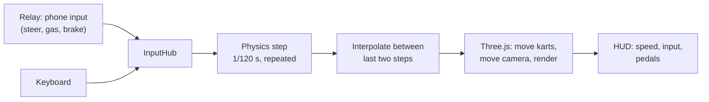

# Phase 3 — A 3D world and karts that drive

**Goal:** every player in the room gets a kart in a 3D arena on the shared screen and drives it from their phone (tilt to steer, thumbs on gas and brake). Keyboards work too, so two people can test at one laptop.

Code: [`game/physics.js`](../game/physics.js) (arcade kart model), [`game/loop.js`](../game/loop.js) (fixed timestep), [`game/input.js`](../game/input.js) (phones + keyboard), [`game/world.js`](../game/world.js) (Three.js scene and cameras), [`game/course.js`](../game/course.js) (arena layout), [`game/main.js`](../game/main.js) (wires it together).

## Try it

1. `npm run dev`, open **https://localhost:5173/game/** on the laptop.
2. Press **↑** to drive P1 with the keyboard, **W** for P2.
3. Scan the QR code with a phone, tap **Tap to start**, hold it like a wheel. Right thumb on **Gas**, left thumb on **Brake** (keep holding to reverse).

| Key (game screen) | Does |
| --- | --- |
| ← ↑ → ↓ | Drive P1 (overrides P1's phone while held) |
| W A S D | Drive P2 (overrides P2's phone while held) |
| C | Camera: auto → group → chase each kart |
| R | Put every kart back on the start line |
| Q | Hide or show the join panel |
| I | Connection stats from Phase 2 (msgs/s, ping, lag) |

## How a frame works



### Three.js in five objects

| Object | Role here |
| --- | --- |
| `WebGLRenderer` | Draws into the full-screen `<canvas>` with the GPU |
| `Scene` | Holds everything: ground, walls, cones, crates, trees, karts, lights |
| `PerspectiveCamera` | Our eye. Moved every frame by the camera logic |
| `Mesh` = geometry + material | Every visible thing. Karts are a `Group` of boxes, cylinders and a sphere |
| Lights | A hemisphere light (sky/ground fill) and a directional "sun" that casts shadows |

No model files or images yet: everything is built from simple shapes, and textures (asphalt, kerbs, the chequered line, name tags) are drawn on a `<canvas>` in code. Real models arrive in Phase 8.

### The fixed timestep

Screens run at 30, 60, 120 or 144 Hz and frames arrive unevenly. If physics moved karts by "however long this frame took", they would handle differently on every machine.

So each frame's real time goes into an **accumulator**, and physics always advances in equal **1/120 s steps** until the accumulator runs low. Whatever is left over (`alpha`, between 0 and 1) says how far between the last two physics states to draw each kart. Motion stays smooth on any screen, and physics is identical everywhere.

If the browser stalls (a background tab), at most 10 steps run per frame instead of trying to catch up on minutes of physics at once. On a very slow machine that means slow motion rather than a frozen game.

## The arcade kart model

Kart racers fake their physics on purpose: a real tyre model is hard to tune and not much fun. Each kart is four numbers: `x`, `z`, `heading` and `speed` (along the nose; negative means reversing).

**Speed**, each step:

| Pedal | Effect |
| --- | --- |
| Gas | +14 m/s² (or +30 m/s² if rolling backwards: gas brakes first) |
| Brake | −30 m/s² while moving forward; once stopped, keeps going to reverse at −9 m/s² |
| Neither | Coasts down at 3 m/s² |
| Always | Air drag of 0.012 × speed², then clamp to −7 … +24 m/s (≈ 86 km/h) |

**Turning:**

```math
\text{turn rate} = \text{steer} \times 2.6\,\text{rad/s} \times \underbrace{\min\left(\tfrac{|v|}{6},\,1\right)}_{\text{no turning on the spot}} \times \underbrace{\left(1 - 0.4\,\tfrac{|v|}{v_\text{max}}\right)}_{\text{a bit less at top speed}} \times \operatorname{sign}(v)
```

The last factor flips steering in reverse, like backing up a real car. The kart always moves the way its nose points (no sliding sideways), which keeps it predictable. Drifting comes in Phase 5.

**Collisions** are circles (1.1 m for a kart):
- **Walls, cones, crates, trees:** push the kart out, remove the speed going into the obstacle, bounce back 25%, keep the rest along the nose. A head-on hit bounces you back; a scrape keeps most of your speed.
- **Kart vs kart:** push apart and swap momentum along the line between them (equal masses), so rear-ending someone shoves them forward.

All of this lives in `game/physics.js` with no Three.js, so `test/physics.test.js` can check it with plain numbers: top speed, braking into reverse, which way "right" turns, a full circle closing on itself, wall bounces, rear-end shoves, and that 30, 60 and 144 fps all give 120 physics steps a second.

## Input: phone or keyboard, the game doesn't care

`InputHub.get(slot)` returns `{ steer, gas, brake, source }` for a player, wherever it came from:
- **Phone:** the latest `input` message from the relay. If none arrives for 500 ms (locked phone, Wi-Fi drop), it counts as hands off, so a kart never drives away on its own.
- **Keyboard:** while any of a player's keys are held, the keyboard wins. Keyboard steering eases in over ¼ s instead of snapping to full lock.

A player gets a kart as soon as their phone joins, or as soon as the keyboard drives their slot.

### The phone's pedals

Two big pads sit under your thumbs while you hold the phone like a wheel: **Brake** on the left, **Gas** on the right. They use **pointer events**, tracking each finger separately, so pressing both at once works and lifting one doesn't release the other. `setPointerCapture` keeps a press alive if your thumb slides off the edge. Android gives a tiny vibration on press; iPhone ignores vibration. Each `input` message now carries `gas` and `brake` alongside `steer`.

## Cameras

| Mode | When | How |
| --- | --- | --- |
| Overview | Nobody's driving | Slowly circles the arena |
| Chase | One kart (or pick one with C) | 8.5 m behind and 4.2 m above, looking 5 m ahead of the kart |
| Group | Two or more karts | Above the middle of the pack; backs off as karts spread apart |

The camera never jumps to its target. Each frame it moves a fraction of the way, `1 − e^(−rate·dt)`, which is smooth and behaves the same at any frame rate. One shared view gets crowded with several karts; split screen comes in Phase 7.

## Tuning

Every kart number is in `KART_PARAMS` at the top of `game/physics.js`. Change one, save, and the game screen reloads. Good first experiments: `maxTurnRate` (nimbleness), `accel` (punch), `topSpeedTurnLoss` (understeer at speed), `wallBounce`.

## Tests

`npm test` runs 66 tests. New this phase: `test/physics.test.js` (20 tests: speed, braking and reverse, steering direction and grip, collisions, interpolation, the fixed step) and `test/input.test.js` (7 tests: phone freshness, keyboard override and hand-back, steering ramp, P1/P2 keys).

## Done when

- [ ] Two players drive their own karts at once from their phones.
- [ ] The camera stays smooth (no jitter or snapping), with one kart and with several.
- [ ] Switching between keyboard and phone mid-drive just works.
- [ ] Steering feels natural: right is right, and you can thread the cone slalom down the middle.

## Next: Phase 4

Replace the open arena with a real track: a closed loop built from a spline, laps, checkpoints, a lap timer and a wrong-way warning.
