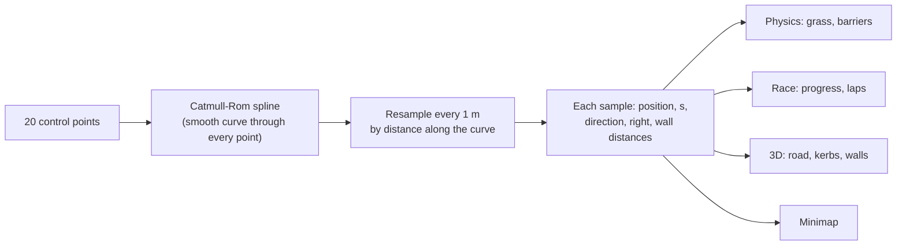
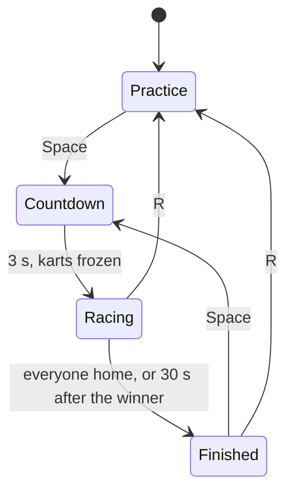

# Phase 4 — A real track with laps

**Goal:** a closed circuit you race round for 3 laps against each other and the clock. A countdown starts the race; checkpoints stop shortcuts; going backwards shows a warning; positions, lap times and a results screen tell you who won.

Code: [`game/track.js`](../game/track.js) (track geometry), [`game/race.js`](../game/race.js) (race rules), [`game/physics.js`](../game/physics.js) (grass and barriers), [`game/world.js`](../game/world.js) (3D track), [`game/minimap.js`](../game/minimap.js), [`game/main.js`](../game/main.js) (HUD and race screens).

## Try it

1. `npm run dev`, open **https://localhost:5173/game/**, join with phones (or press ↑ / W for keyboard karts).
2. Press **Space** (or click **Start race**). Everyone goes back to the grid, the lights count 3, 2, 1, GO.
3. Race 3 laps. Space after the results starts another race; **R** goes back to practice.

For quick tests, open **https://localhost:5173/game/?laps=1**.

| Key | Does |
| --- | --- |
| Space / Enter | Start a race (from practice or the results screen) |
| R | Back to practice: cancel the race, everyone to the grid |
| G | Show the checkpoint gates (yellow) |
| C, Q, I, arrows, W A S D | As in Phase 3 |

## The track: from a few points to a road

**Kerb Valley** is defined by 20 control points in `TRACK_LAYOUT`. Everything else is computed from them.

1. **Spline.** A *Catmull-Rom* spline is a smooth curve that passes through every control point, so the points you write down are where the road goes. We use the *centripetal* variant, which won't loop or overshoot when points are unevenly spaced. Three.js has one built in (`CatmullRomCurve3`), but ours is 20 lines in `track.js`, so physics and tests don't need Three.js.
2. **Resample by distance.** Points straight off the spline bunch up in corners. We measure the curve and resample it every 1 m, so each sample's `s` is true distance along the lap. `s = 0` is the finish line, and a lap is about 968 m.
3. **Direction and "right".** Each sample stores its direction of travel and the direction to the driver's right. Directions are measured over ±4 m, which smooths away tiny kinks where the spline passes through a control point.
4. **Barrier distances.** The tyre walls sit 16 m from the centre line. On the inside of a tight corner, a wall that far out would fold over itself (picture drawing a circle of radius 10 m with a pen held 16 m to one side). So each sample measures how tight the bend is, and the inside wall comes in to just within that radius, smoothed so it has no kinks. A test checks no wall ever folds back.

### Locating a kart on the track

`track.locate(x, z, hint)` answers "where is this kart?" with:
- `s`: distance along the lap
- `lateral`: how far off the centre line (positive = right)
- the wall distances there

It finds the nearest sample, then refines between samples so `s` is smooth. With a **hint** (last step's sample) it only searches ±12 m, which is fast and can never jump to another part of the track that happens to be nearby across the grass.

## Grass and barriers

| Where | What happens |
| --- | --- |
| Road and kerbs (within 8.2 m of the centre) | Normal driving |
| Grass | Top speed capped at 11 m/s (~40 km/h); faster karts slow at 30 m/s², more than the gas can push |
| Tyre wall | Same bounce as Phase 3's walls: push back onto the track, lose the speed going into the wall, keep the rest |

Grass punishes running wide without stopping you dead; walls keep everyone near the track.

## Race rules

### Progress, checkpoints and laps

Each racer has **progress**: total distance driven along the track. Every physics step it adds how much `s` changed, the short way round the loop. So driving forward adds, reversing subtracts, and crossing the finish line (where `s` wraps from 968 back to 0) counts as about +0.2 m, not −968.

| Rule | How |
| --- | --- |
| 8 checkpoints per lap | Gates at every ⅛ of the lap; the 8th is the finish line. They must be passed in order (G shows them) |
| A lap | Progress passes another whole lap, through every gate |
| No shortcuts | A progress jump of more than 5 m in one step (a respawn, a glitch) is ignored; the ±12 m search can't skip across the infield; walls stop corner-cutting |
| Reversing over the line and back | Doesn't count: progress goes down, then has to come back up |
| Starting on the grid | Karts start just behind the line with slightly negative progress, so lap 1 includes the run-up |
| Wrong way | Moving backwards along the track faster than 2 m/s for 0.8 s shows "P2 · WRONG WAY"; it clears when you turn round |
| Positions | Finishers by finish time, then everyone else by progress |
| Finishing | After the last lap. The others get 30 s, then a DNF. A player who leaves the room is also a DNF |

### Timing on the physics clock

The race clock is the sum of physics steps (1/120 s each), not the wall clock. Lap times are exact and identical on every computer, even if the browser stutters. The countdown carries its leftover fraction into the race, so no time is lost at GO.

All of these rules live in `race.js` with no browser code. `test/race.test.js` drives stand-in karts along the centre line to check them.

## On screen

| Element | Shows |
| --- | --- |
| Race panel (top) | Practice: how to start, the lap record. Racing: race clock and leader |
| Countdown | 3, 2, 1, GO! across the middle of the screen |
| Player chips (bottom left) | Place, speed, input, lap x/3, current lap time, best lap; ordered by place. Late joiners show "next race" |
| Alerts | "P1 · FINAL LAP" for 2 s; "P2 · WRONG WAY" flashing while it lasts |
| Toasts (right) | Each lap time, finishes, new lap records |
| Minimap (bottom right) | The track from above, a dot per kart, the leader outlined in white |
| Results | Order, total time, best lap, record |

The **lap record** (fastest lap ever on this track, on this screen) is saved in the browser's `localStorage`.

### The 3D track

The road, kerbs and walls are **ribbons**: one long strip of triangles following the samples at fixed sideways offsets (for walls, at each sample's wall distance, standing up). Textures repeat along the strip a whole number of times, so the seam at the finish line matches. The finish has a chequered line, a gantry with the track name and painted grid boxes.

The ~150 trees use **instancing**: one `InstancedMesh` per tree part holds every tree's position, so all of them draw in 3 calls instead of about 450. The sun's shadow box follows the camera, so a big track still gets sharp shadows where you're looking.

## For debugging

- In development, the browser console has `kart` with the live `race`, `physics`, `track`, `input` and `world`. Try `kart.race.standings()` or `kart.track.locate(0, 90)`.
- `?laps=1` on the game screen's address sets the race length (1 to 20).

## Tests

`npm test` runs 90 tests. New this phase:
- `test/track.test.js` (11): the loop closes, directions, track parts far enough apart, barriers never fold, locate and hints, the grid.
- `test/race.test.js` (10): countdown, three full laps through every checkpoint, exact lap times, standings, reversing over the line, jumps, wrong way, grace period and DNF, a player leaving.
- `test/physics.test.js` now covers grass and barriers instead of the Phase 3 arena.

## Done when

- [ ] You finish a 3-lap race with the phone.
- [ ] Cutting corners doesn't count a lap.
- [ ] Driving backwards triggers the warning.
- [ ] Two players race, and the results screen shows the right winner.

## Next: Phase 5

Make driving fun on its own: drifting with a mini-turbo, boost pads, a ramp, and "juice" (speed lines, camera kick, sparks, phone vibration): [phase-5-feel.md](phase-5-feel.md).
