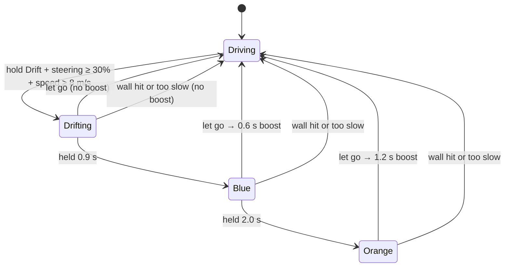

# Phase 5 — Kart feel: drift, boost, juice

**Goal:** driving is fun on its own, before any opponents. Drift through corners to charge a mini-turbo, hit boost pads, fly off a jump, and feel it all: sparks, flames, speed lines, camera kicks and your phone buzzing in your hands.

Code: [`game/physics.js`](../game/physics.js) (drift, boost, jumps), [`game/track.js`](../game/track.js) (pads and ramp), [`game/feedback.js`](../game/feedback.js) (events → shake and vibration), [`game/world.js`](../game/world.js) (effects), [`game/tuning.js`](../game/tuning.js) (live tuning panel), [`controller/main.js`](../controller/main.js) (drift pad, vibration).

## Try it

| On the phone | Does |
| --- | --- |
| **Gas** (right thumb) | Accelerate |
| **Drift** (left thumb, top) | Hold while turning to drift. The pad glows **blue**, then **orange** as the mini-turbo charges. Let go for the boost |
| **Brake** (left thumb, bottom) | Brake; hold to reverse |

| On the game screen | Does |
| --- | --- |
| Right Shift (with arrows) / Left Shift (with W A S D) | Drift for P1 / P2 |
| T | Tuning panel: every handling number as a slider, live |

Then look for the **boost pads** (orange chevrons: left lane of the back straight, right lane of the main straight) and the **ramp** (yellow and black) on the back straight. Hit the first pad and you'll fly further off the ramp.

## Drifting

A drift is a decision you commit to. Press drift while steering at speed, and the kart locks into a turn in that direction until you let go.



| While drifting | Rule |
| --- | --- |
| Turning | Always turns the drift's way, and follows the wheel. Wheel straight: a gentle arc (0.35 × normal full lock). Fully **into** it: tight (1.15 ×). Fully **out**: nearly straight (0.1 ×). Like normal steering, it turns less at top speed. You can't straighten up completely without letting go |
| Speed | Loses 1.5 m/s² while sliding |
| Charging | Only on the road and on the ground: grass and air pause the timer |
| Ending | Let go for the mini-turbo. Hitting a wall or dropping below ~5 m/s ends it with nothing |

**Tuning note (after first phone test).** The first version turned at a fixed 0.45–1.2 × full lock *whatever the speed*, so even a straight wheel turned harder mid-drift than full lock does normally at speed. With tilt steering that felt like the kart spinning on its own. Now the drift turn is two straight lines through `driftTurnBase` and is scaled by the same speed grip as normal steering. At 20 m/s:

| Wheel (into the drift) | Normal | First version | Now |
| --- | --- | --- | --- |
| −100% (counter-steer) | n/a | 1.17 rad/s | 0.17 rad/s |
| 0% | 0 | 2.15 rad/s | 0.61 rad/s |
| 20% | 0.35 rad/s | 2.34 rad/s | 0.88 rad/s |
| 50% | 0.87 rad/s | 2.63 rad/s | 1.30 rad/s |
| 100% | 1.73 rad/s | 3.12 rad/s | 1.99 rad/s |

**The slide is visual.** The physics kart still moves along its heading, just turning harder. What you see swings the kart's nose 23° into the turn on a separate "drifter" group, so it looks like it's sliding sideways. This is how most kart racers do it: predictable for the player, easy to tune, no unstable tyre maths.

## Boost

A boost is a countdown (`kart.boost`, seconds). While it runs:
- top speed rises from 24 to 31 m/s (86 → 112 km/h), with an extra 30 m/s² push
- grass doesn't slow you, so a boost can carry you across a corner of grass

When the boost ends, extra speed bleeds off at 10 m/s² instead of snapping back to the limit. That gentle fade is a big part of why boosts feel good.

| Source | Boost |
| --- | --- |
| Blue mini-turbo | 0.6 s |
| Orange mini-turbo | 1.2 s |
| Boost pad | 1.2 s, and at least top speed straight away |

## Jumps

Karts now have height (`y`) and vertical speed (`vy`):

1. On the ramp, the ground rises along it (`track.groundHeight`), and the kart follows it. Its climbing speed is remembered.
2. Off the end, the ground drops away. The kart flies with that climbing speed as `vy`. Faster in means higher and further.
3. In the air: gravity 22 m/s² (heavier than real, which feels snappier), pedals do nothing, steering works at 30%.
4. Landing fires a `land` event: squash, a small camera bump, a buzz on the phone.

At top speed the ramp gives about 0.6 s of air and 14 m. Coming off a boost pad, closer to 20 m.

## Pads and ramps are data

Features are listed in `TRACK_LAYOUT.features` with a rough position (`near`) and a lane (`lateral`). When the track is built, each is snapped onto the centre line, so `s` (distance along the lap) is computed, not hand-typed:

```js
{ type: 'boost', near: [-50, -133], lateral: -3, length: 6, width: 4 },
{ type: 'ramp',  near: [9, -126],   length: 8, height: 1.4 },
```

Physics asks `track.boostPadAt(where)` and `track.groundHeight(where)`. The 3D scene builds pad strips and the ramp from the same numbers.

## Juice

"Juice" is everything that makes an action *feel* bigger without changing what it does.

| Effect | How |
| --- | --- |
| Drift swing and lean | The drifter group rotates 23° into the drift; the body leans |
| Sparks | One `THREE.Points` pool of 400 soft dots with additive blending. Rear wheels emit them while drifting: pale, then blue, then orange as the charge grows |
| Boost flame | A glowing cone behind the kart, flickering in length |
| Field of view | Widens with speed (+5°) and more while boosting (+9°), so speed feels faster |
| Speed lines | A CSS overlay (a repeating cone gradient with a clear centre) fades in during a boost |
| Camera shake | "Trauma" builds on hits, bumps and landings and decays at 1.8/s; the shake is trauma², so small knocks barely move it |
| Landing squash | The kart squashes and springs back |
| Pads | Chevrons scroll forward |

The tuning panel's **juice** slider scales shake and FOV kick (0 = off, 2 = double).

## Telling the phone: the game → phone channel

Until now messages only went phone → game. Phase 5 adds the return path through the relay:

| From → to | `type` | Fields | Meaning |
| --- | --- | --- | --- |
| Game → server | `to-player` | `slot`, `data` | Deliver `data` to that player's phone. Only the game screen may send this |
| Server → phone | `from-game` | `data` | `{ buzz?: [ms, pause, ms…], drift?: -1 \| 0 \| 1 \| 2 }` |

`feedback.js` decides what to send:

| Event | Phone buzz (ms) | Camera |
| --- | --- | --- |
| Wall hit (≥ 2 m/s lost) | 20–90, harder hits longer | Shake up to 0.6 |
| Kart bump | 25 | 0.15 |
| Boost pad | 40, pause 30, 40 | 0.08 |
| Drift blue / orange | 12 / 12-40-12 | – |
| Mini-turbo blue / orange | 30 / 30-20-60 | – / 0.06 |
| Landing | 35 | 0.12 + squash |

Rules that keep it sane:
- At most one buzz per phone every 120 ms. Scraping a wall reports a hit every physics step, 120 per second.
- The drift level is sent only when it changes, so the drift pad glows the right colour.
- Everything for one phone in one frame goes in one message.

`navigator.vibrate` works on **Android Chrome**. **iPhone Safari doesn't support vibration**, so iPhones get the glowing drift pad and the effects on the big screen instead.

## Tuning while you drive

Press **T** on the game screen. Every number in `KART_PARAMS` has a slider, grouped into Speed, Steering, Drift, Boost & jumps, and Grass & walls. Changes apply on the next physics step and are saved in the browser. **Copy as code** puts the current values on the clipboard as a `KART_PARAMS` block to paste into `physics.js`; **Reset to defaults** undoes everything.

Good things to try:
- `driftTurnBase`: how hard a drift turns with the wheel straight. Lower it if drifts feel twitchy
- `driftTurnIn` / `driftTurnOut`: how much tighter or wider the wheel can make a drift
- `driftLevel1` / `driftLevel2`: how long to hold for each charge
- `boostSpeed` and `overSpeedDrag`: how big a boost feels and how long it lingers
- `gravity`: floaty or snappy jumps

In development, the console also has `kart.params`.

## Tests

`npm test` runs 112 tests. New this phase:
- `test/physics.test.js`: drift start conditions, into vs out of the drift, small tilts giving gentle drift turns, charge levels and mini-turbos, no boost without charge, fizzling out, boost top speed and fade, boosting over grass, pads (hit and miss), the ramp launch and landing, the air, a wall ending a drift.
- `test/track.test.js`: features on the road, the ramp slope, pad patches.
- `test/feedback.test.js` (5): event → buzz and shake mapping, scrape filtering, the 120 ms limit, landing squash, drift-level messages.
- `test/relay.test.js` and `test/input.test.js`: the `to-player` channel, the `drift` input, Shift keys.

## Done when

- [ ] Drifting through a corner and releasing on orange is faster than driving it normally.
- [ ] The drift pad glows blue, then orange, on the phone.
- [ ] Android phones buzz on bumps, boosts and landings.
- [ ] The boost pad into the ramp makes a satisfying jump.
- [ ] A friend picks up the phone, drives 3 laps, and asks to go again.

## Next: Phase 6

AI opponents that follow the track (and drift!), plus item boxes and three original items.
